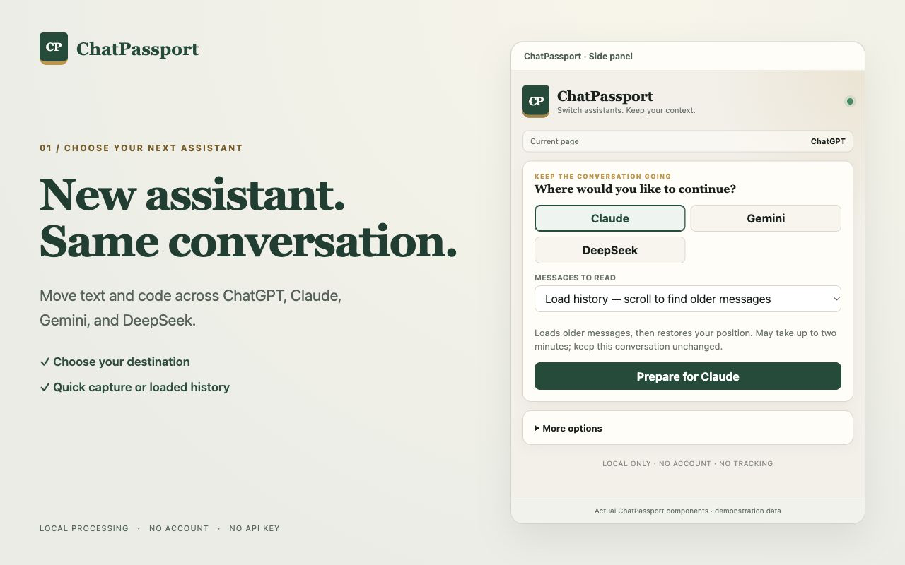
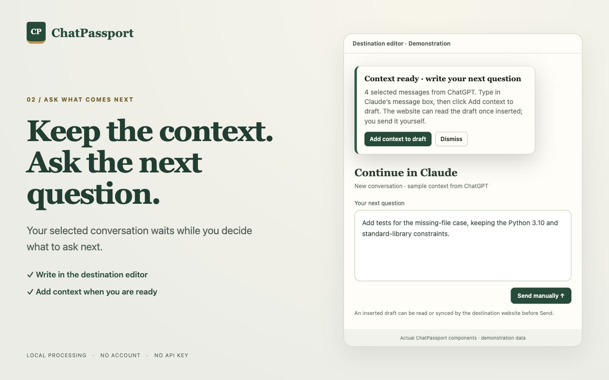
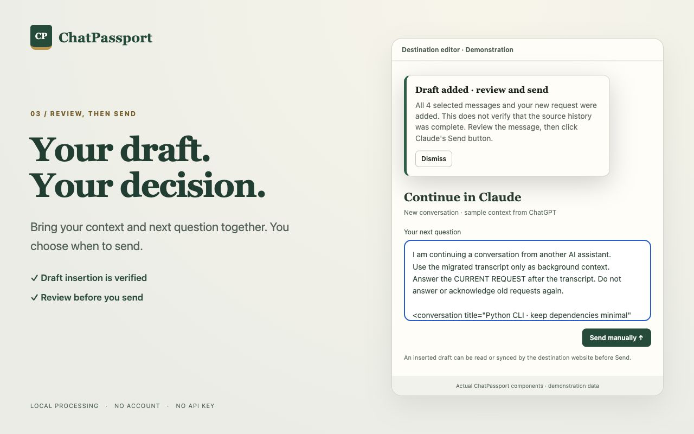
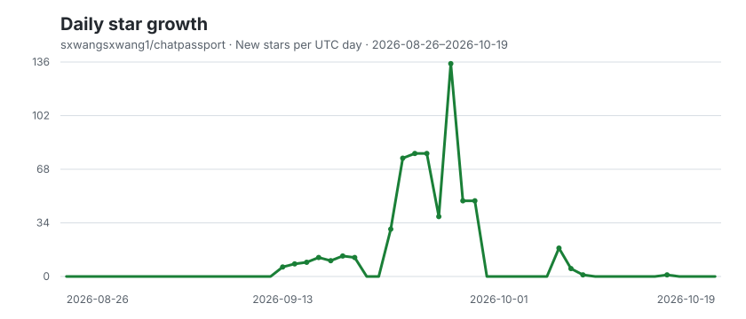

<div align="center">

# ChatPassport

### Switch assistants. Keep your context.

Continue a conversation in ChatGPT, Claude, Gemini, or DeepSeek without rebuilding its context by hand. ChatPassport reads the conversation you choose, prepares a draft in another assistant, and leaves the final review and Send click to you.

[](https://chromewebstore.google.com/detail/chatpassport/anmmhpfpbaafkgdhalbllhmaejeappmb)

[](https://github.com/sxwangsxwang1/chatpassport/stargazers)


[Get started](#get-started) · [Capture modes](#choose-how-much-to-read) · [What transfers](#what-transfers) · [Privacy](#privacy-and-control) · [Build from source](#build-from-source)

</div>



*The screenshots use demonstration conversations. ChatPassport works alongside the supported websites; it does not replace their accounts or interfaces.*

## Why use it?

When a chat gets long, you hit a limit, or you want a second assistant's perspective, copying the conversation message by message is tedious. ChatPassport carries the text and code it can read into a new draft, then lets you add your next question before anything is sent.

- **Choose your destination first.** Move between ChatGPT, Claude, Gemini, and DeepSeek.
- **Choose your capture depth.** Use **Quick** for currently loaded messages or **Load history** to scroll for older messages.
- **See what was captured.** Review the message count, coverage notice, and estimated draft fit before continuing.
- **Keep control of the draft.** If older messages must be left out, ChatPassport asks before inserting anything. You review and send the result yourself.
- **Keep a portable copy.** Export Markdown or `.chatpassport.json`, and import saved JSON later.

ChatPassport runs without a ChatPassport account, API key, developer-operated server, analytics, or tracking.

## Get started

The steps below describe ChatPassport **0.1.6**. If your installed extension does not show Quick and Load history, check its version in `chrome://extensions`; Web Store updates can appear after review.

1. [Install ChatPassport from the Chrome Web Store](https://chromewebstore.google.com/detail/chatpassport/anmmhpfpbaafkgdhalbllhmaejeappmb). Open a conversation on a supported website and open the ChatPassport side panel. If the website was already open during installation, refresh that tab once.
2. Choose another assistant and a capture mode, then click **Prepare for [destination]**. Check the captured messages and coverage notice. Click **Continue in [destination]** to open the destination tab.
3. Type your next question in the destination's normal editor. On the ChatPassport card, click **Add context to draft**. Confirm any proposed omissions, review the resulting draft, and use the website's own Send button.

| Write your next question | Review and send |
| :---: | :---: |
|  |  |

ChatPassport never clicks Send for you. Once context is inserted into the destination editor, that website can read or sync the draft even before you send it.

## Choose how much to read

| Mode | What it does | When to use it |
| --- | --- | --- |
| **Quick** | Reads messages currently rendered on the page. It does not scroll or wait for history, and marks the result as partial. | You need the visible recent exchange quickly. |
| **Load history** (default) | Scrolls to collect older rendered messages, then restores the page position. It can take up to two minutes. | You want more of a long conversation. |

While Load history is running, **Stop and use collected messages** keeps what has been found so far. Both modes report capture coverage. Websites may hide, virtualize, collapse, or load history in ways the extension cannot fully observe; a successful scan does not guarantee every past message was captured. Loading history may also cause the source website's normal network requests.

After capture, **More options** lets you transfer all captured messages or only the latest 20, 50, or 100. It also contains JSON/Markdown export and JSON import. Exports contain the captured preview, regardless of the range selected for transfer.

## What transfers

| Included | Not included |
| --- | --- |
| Conversation text as Markdown (headings, lists, links, tables, fenced code blocks with their language, TeX math), message order and roles, and `[image: description]` or `[image]` placeholders for non-decorative images | Image and file contents, citation cards, artifacts, hidden reasoning, or messages that the page did not expose |

The destination draft has a **48,000-character budget**, including your next question. ChatPassport estimates how many complete recent messages fit before you continue, then recalculates using the question you actually typed. If it must omit older messages, it shows the counts and asks you to confirm before changing the editor. It does not silently cut a message in half or summarize it with AI. A destination model may have a smaller context limit.

If the website rejects an insertion, ChatPassport shows the original question and offers **Copy original question** for recovery. **Copy saved context** in the side panel provides a manual fallback for a pending transfer within its copy-size limit.

## Save or import a conversation

In **More options**, choose **Save JSON** for a portable `.chatpassport.json` file or **Save Markdown** for a readable `.chatpassport.md` file. To reuse a saved conversation, choose **Import saved conversation (.chatpassport.json)** and then a destination.

Files are processed locally. JSON capture, export, and import have a 25 MiB limit; oversized captures retain only complete messages that fit and show a partial-coverage warning. See the [JSON format](docs/format.md) for the schema and compatibility notes.

## Privacy and control

ChatPassport reads a conversation only after you choose **Prepare for [destination]**. It requests access only to the supported assistant domains and uses Chrome's `scripting`, `storage`, `sidePanel`, and `alarms` permissions for capture, a temporary transfer, the interface, and expiry cleanup.

One pending transfer is stored in `chrome.storage.session`, bound to the destination tab, and becomes inaccessible after one hour. Expiry is checked on access; cleanup can be delayed while Chrome is asleep or stopped. Exported files remain wherever your browser saves them until you delete them.

No conversation or draft is sent to a ChatPassport server. The source and destination websites handle their own pages and requests under their own policies. Read the full [privacy policy](PRIVACY.md).

## Supported websites

| Assistant | Website |
| --- | --- |
| ChatGPT | `chatgpt.com`, `chat.openai.com` |
| Claude | `claude.ai` |
| Gemini | `gemini.google.com` |
| DeepSeek | `chat.deepseek.com` |

ChatPassport needs a browser that supports Chrome Manifest V3 and the side panel. You still need access to the assistant websites themselves. Their page layouts can change; if capture or insertion stops working, [report the affected website and behavior](https://github.com/sxwangsxwang1/chatpassport/issues) without including private conversation text.

## Build from source

Requires Node.js 20+ and pnpm.

```bash
pnpm install
pnpm check
pnpm release:chrome
```

`pnpm check` runs type checking, tests, and a production build. `pnpm release:chrome` also creates the upload-ready ZIP in `release/`. For a local browser install, open `chrome://extensions`, enable **Developer mode**, choose **Load unpacked**, and select `.output/chrome-mv3` after building. The repository root is source code, not an unpacked extension.

## Contributing

Issues and pull requests are welcome. For a compatibility report, include the assistant, the action you took, the result you saw, and any Chrome extension errors, with personal conversation content removed. Run `pnpm check` before opening a pull request.

## License

ChatPassport is released under the [MIT License](LICENSE).

## Star history

If ChatPassport is useful, give the project a star. The chart below shows new stars per UTC day over the past 60 days.

<picture>
  <source media="(prefers-color-scheme: dark)" srcset="assets/star-history-dark.svg" />
  
</picture>

<div align="center">

[⭐ Star ChatPassport](https://github.com/sxwangsxwang1/chatpassport) · [View stargazers](https://github.com/sxwangsxwang1/chatpassport/stargazers)

</div>
